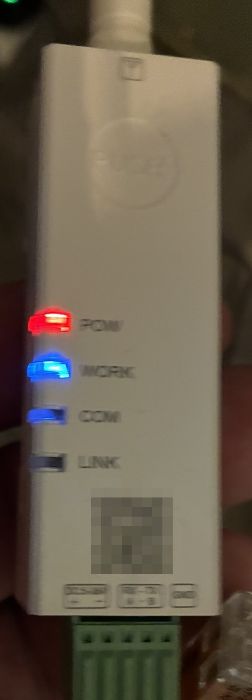
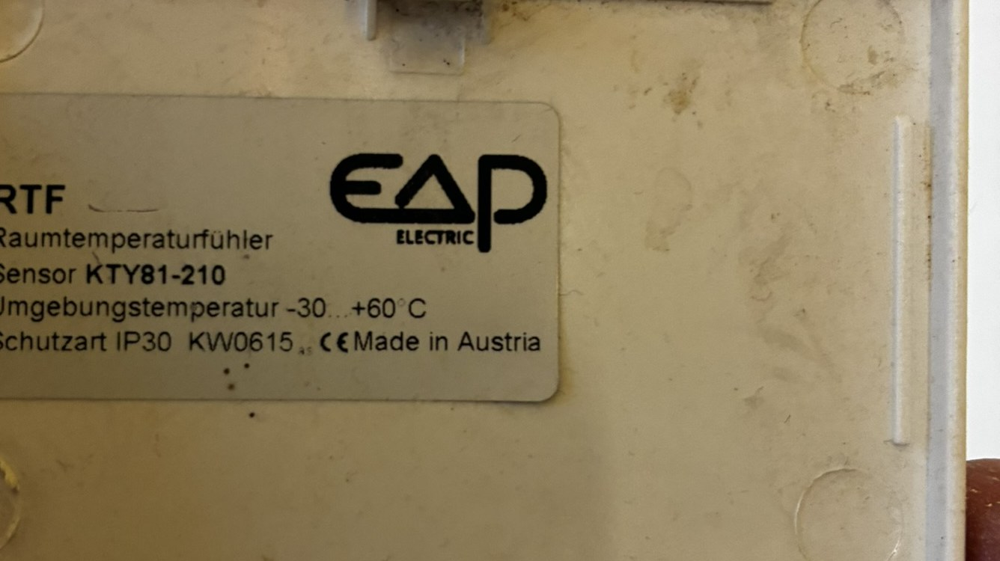
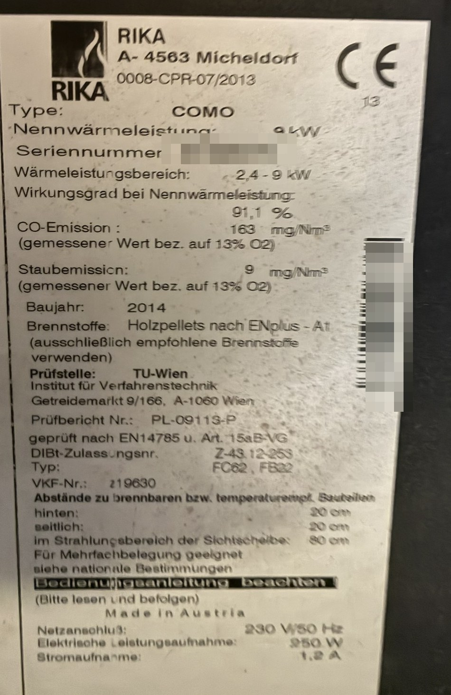
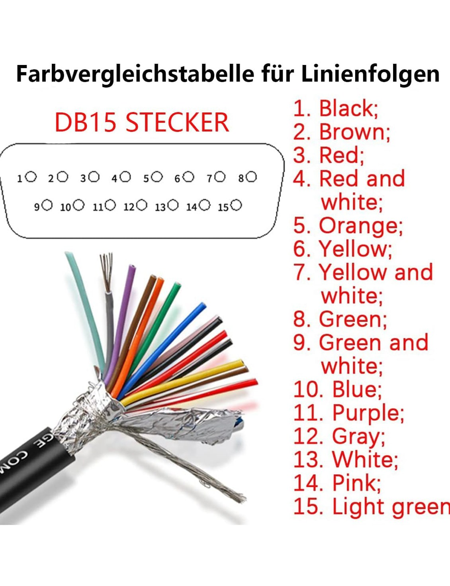

# RIKA Pelletofen über Seriell statt GSM
### Memo · Pico · Como · Revo · Topo → Home Assistant

[English](README.md) · **Deutsch** · [Français](README.fr.md)

Diese Öfen haben eine 15-polige Buchse, die für ein GSM-Modem gedacht war:
Man schickte dem Ofen eine SMS, er antwortete mit einer. Das Modem ist längst
weg und der Mobilfunkvertrag mit ihm — **die Buchse spricht aber weiter**,
und zwar eine ganz gewöhnliche serielle Schnittstelle.

Dieses Projekt setzt einen WLAN-Seriell-Wandler dorthin, wo früher das Modem
saß, und lässt Home Assistant direkt mit dem Ofen reden. Keine SMS, keine
SIM-Karte, keine monatlichen Kosten. Auch nicht gelötet und ohne
Mikrocontroller: Schraubklemmen und eine App.

Gemessen an einem **RIKA Como, Baujahr 2014**. Dieselbe Schnittstelle und
dasselbe Tastendisplay-Menü gibt es bei Memo, Pico, Revo und Topo — dort
ungeprüft, aber das Protokoll gehört dem Ofen, nicht dem Modell.

| | |
| --- | --- |
| ein / aus | ja |
| Heizleistung in Prozent | ja |
| Raumtemperatur in °C | ja, mit angeschlossenem RIKA-Raumsensor |
| Störmeldungen aufs Telefon | ja |
| Zustand auf Abruf | **nein** — siehe *Grenzen* |

Kosten: rund 56 €. Die fertige Box für dieselbe Aufgabe kostet 299 €.

---

## Warum es das gibt

RIKA-Öfen dieser Generation haben eine Buchse für ein
**Cinterion BGS2RT-RS232 GSM-Modem**. Das Modem ist Geschichte, die
Schnittstelle nicht.

[n-serrette/esphome_rika_gsm](https://github.com/n-serrette/esphome_rika_gsm)
bildet dieses Modem bereits auf einem ESP32 nach, und dieses Projekt ist
entstanden, indem ich es gelesen habe — Anerkennung, wem sie gebührt. Der
Unterschied:

| | esphome_rika_gsm | hier |
| --- | --- | --- |
| Hardware | ESP32, am Ofen verdrahtet | **WLAN-Seriell-Wandler** |
| Verdrahtung | löten, Pegelwandler | Schraubklemmen |
| läuft als | ESPHome-Bauteil | **Home-Assistant-App** |
| geprüft an | Revo | **Como (Tastendisplay)** |

Wer gern lötet, nehme das ESPHome-Bauteil — das ist die elegantere Lösung.
Dieses hier ist für alle, die lieber schrauben.

---

Der Einbau steht in [docs/INSTALL.md](docs/INSTALL.md), das Gemessene in [docs/NOTES.md](docs/NOTES.md).

## Hardware

| Teil | Hinweis | ca. |
| --- | --- | --- |
| **PUSR USR-DR162** | die RS232-Ausführung, **nicht** DR164 (das ist RS485) | 32 € |
| **DA-15-Kabel, Stecker, 1,5 m** | zwei Reihen, 8 + 7 Pole. *Nicht* die dreireihige VGA-Bauform | 15 € |
| 12-V-Netzteil | auf dem Gehäuse steht `DC 5-24V`; 12 V lässt Luft | 9 € |

**Das Netzteil ist die einzige Stelle, an der ein Fehler etwas zerstört.**
Unseres hatte einen Hohlstecker: abschneiden, zwei Adern abisolieren und
**messen, welche die positive ist**, bevor sie an die Klemme kommt. Netzteil
einstecken, die blanken Enden auseinanderhalten, Messgerät auf Gleichspannung
— +12 V heißt, diese Ader ist Plus. Alles andere in diesem Aufbau geht im
Fehlerfall bloß nicht; verpolte Versorgung zerstört den Wandler.

Das ist die vollständige Stückliste. Andere WLAN-Seriell-Wandler gibt es, und
sie täten vermutlich dasselbe — aber **gemessen wurde dieser hier**, und für
Hardware, die nicht auf dem Tisch lag, wird hier nichts behauptet.

Eines ist nicht austauschbar: Der Wandler muss **echtes RS-232** können, kein
3,3-V-TTL. Die Pins 2 und 3 des Ofens führen RS-232-Pegel.

### Wie es aussieht

| | |
| --- | --- |
|  | Der USR-DR162 im Betrieb. POW und WORK leuchten, COM flackert bei jeder Abfrage. Der QR-Code ist maskiert. |
|  | Der RIKA-Raumsensor ist ein **KTY81-210** — ein schlichter Widerstand mit zwei Adern, die Polung ist egal. |
|  | Der Ofen, an dem gemessen wurde: COMO, 9 kW, Baujahr 2014. Beachtenswert: **250 W elektrisch** — nahe an den 277 W, die beim Zünden gemessen wurden. Seriennummer maskiert. |
|  | Die Farbtabelle des Kabels. **Trotzdem durchklingeln** — bei unserem sah Pin 4 nach rot/schwarz aus, die Tabelle sagt rot/weiß. |

### Verdrahtung

```
Ofen Pin  3   ->  Wandler RX      die Sendeleitung des Ofens
Ofen Pin  2   ->  Wandler TX      offen lassen, bis man mitlesen kann
Ofen Pin 15   ->  Wandler GND
```

Mit dem optionalen RIKA-Raumsensor, im selben Stecker:

```
Ofen Pin  4   ->  Fühler Signal
Ofen Pin  5   ->  Fühler Masse    (Pin 5 und Pin 15 sind dasselbe Potential)
```

Pin 1 führt 5 V. Dieses Projekt nutzt sie nicht.

**Serielle Einstellungen: 38400, 8, None, 1, keine Flusssteuerung.** Andere
Modelle weichen ab — das ESPHome-Projekt nennt 38400 für Revo und TOPO,
115200 für ROKO.

> **Fang mit Zuhören an.** Nur Pin 3 und Pin 15 anklemmen, TX offen lassen,
> den Wandler in den TCP-Server-Betrieb. Ist die GSM-Funktion am Ofen
> eingeschaltet, kommt alle 5,5 Sekunden ein `ATE0`. Solange TX nicht
> angeschlossen ist, kann nichts beim Ofen ankommen — ein guter Ort, solange
> man sich der Belegung noch nicht sicher ist.

---

## Einrichten

1. `addon/` als `rika_gsm/` in das App-Verzeichnis von Home Assistant
   kopieren, den Store neu laden, installieren.
2. Einstellen:

```yaml
host: "192.168.1.100"      # der serielle Wandler
port: 8899
pin: "1234"                # vierstelliger Empfangscode, Ofenmenü SETUP -> CODE
phone: "++436641234567"    # siehe unten — das doppelte Plus ist Absicht
http_port: 8098
state_file: "/share/rika/state.json"
```

3. `homeassistant/rika_stove.yaml` nach `config/packages/` kopieren und
   **Home Assistant neu starten** — `reload_all` lädt `rest_command` nicht
   mit, und die Knöpfe täten dann stumm gar nichts.

### Warum der Ofen eine Rufnummer braucht — und das doppelte Plus

**Ohne hinterlegte Nummer meldet der Ofen Störungen nicht.** Nicht später,
nicht leiser: gar nicht. `FAILURE: no pellets`, `WARNING: door open`, eine
ausgelöste Rückbrandklappe — nichts davon verlässt den Ofen, solange er
nicht glaubt, einen Empfänger zu haben. Antworten auf eigene Befehle kommen
weiterhin; die unaufgeforderten Meldungen nicht.

Das ist der ganze Zweck von `TEL`. Verschickt wird nie eine SMS — die App
ist das Modem, es verlässt nichts das Haus —, aber der Ofen redet nur von
sich aus, wenn eine Nummer hinterlegt ist.

Und sie muss eine sein, die er annimmt. Damit zum Plus.

Der Ofen speichert beim `TEL`-Befehl die Absendernummer aus dem
`+CMGR`-Kopf — und **schneidet das erste Zeichen ab**:

```
gesendet "+436641234567"  ->  gespeichert "436641234567"
gesendet  "06641234567"   ->  gespeichert  "6641234567"
```

Ohne führendes `+` hält er die Nummer für unvollständig, hängt
`PLEASE SAVE TEL NUMBER` an **jede** Antwort und schickt Störmeldungen nicht
von selbst. Ein Opferzeichen davor behebt es.

Es wird nie eine SMS verschickt — die Nummer ist nur eine Beschriftung im
Ofen.

---

## Was man bekommt

| Entität | |
| --- | --- |
| `sensor.rika_stove_message` | die letzte Meldung des Ofens, wörtlich |
| `binary_sensor.rika_stove_gsm` | ob der Ofen sein Modem gerade sieht |
| `binary_sensor.rika_stove_fault` | letzte Meldung beginnt mit `FAILURE` |
| `script.rika_stove_off` / `_on` | |
| `script.rika_stove_power_30/60/100` | Heizleistung |
| `script.rika_stove_room_temperature` | nutzt `input_number.rika_stove_setpoint` |

Eigene Befehle:

```yaml
action: rest_command.rika_stove_command
data:
  command: "h75"
```

Den Empfangscode setzt die App davor — er steht also nirgends in der
Konfiguration.

---

## Befehle

Gemessen an einem Como mit Tastendisplay:

| geht | braucht etwas | abgelehnt (`FAILURE: text Error`) |
| --- | --- | --- |
| `TEL`, `ON`, `OFF`, `h<Prozent>` | `room`, `r<Grad>` — Raumsensor | `?`, `?+`, `SYNC`, `SAVE`, `FON` |

Antworten kommen im Klartext: `STOVE ON - HEAT 60%`, `STOVE OFF`,
`FAILURE: no pellets`, `WARNING: door open` und so weiter.

**`FAILURE: text Error` heißt nicht „Befehl unbekannt".** Vor dem Anschließen
des Raumsensors ergab `room` ein `text Error`, danach dasselbe Wort
`STOVE ON - ROOM 21`. Der Ofen antwortet genauso, wenn ihm eine Voraussetzung
fehlt.

(Bei `FON` war der Frostschutz im Ofenmenü abgeschaltet — ob der Befehl fehlt
oder nur nichts anzuwenden war, ist deshalb offen.)

---

## Grenzen

**Es gibt keine Statusabfrage.** `?` existiert erst ab Ofensoftware 1.12; auf
dieser Generation wird es abgelehnt. Man kennt immer nur die *letzte Meldung*,
nie den aktuellen Zustand. Deshalb gehört ein Zwischenstecker mit
Leistungsmessung dazu: Unserer zieht 2,5 W im Stillstand und 270 W beim
Zünden. Das ist es, was verrät, ob der Ofen wirklich brennt.

**Die App muss durchlaufen.** Der Ofen fragt alle fünf Sekunden nach seinem
Modem und schaltet GSM nach etwa dreißig Sekunden Stille ab — und wieder
einschalten kann das nur ein Mensch am Tastendisplay.

**Warnungen verschickt er nicht von selbst.** Laut Anleitung meldet der Ofen
Störungen selbsttätig, Warnungen aber nur als Beipack zu einer Antwort.

**Umfang.** Geprüft an einem Ofen, einem Wandler, einem Haus. Berichte über
andere Modelle sind willkommen; Unterstützung kann ich nicht zusagen.

---

## Lizenz

MIT. Benutzen, ändern, verkaufen — und bitte den zweiten Absatz der Lizenz
beachten, den über die fehlende Gewährleistung. Hier wird ein Feuer ein- und
ausgeschaltet.

## Dank

[n-serrette/esphome_rika_gsm](https://github.com/n-serrette/esphome_rika_gsm)
— die Modem-Nachbildung ist daran entwickelt. Drei seiner
Entwurfsentscheidungen sind wesentlich und leicht falsch zu machen: die
wartende SMS behalten, bis der Ofen sie mit `AT+CMGD` löscht; sie als
`"REC READ"` ankündigen (nicht `UNREAD`); und **zwei** Zeilenenden hinter den
Nachrichtentext setzen.
