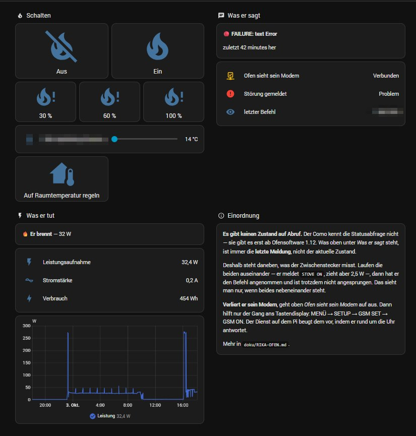

# Poêle à granulés RIKA en liaison série au lieu du GSM
### Memo · Pico · Como · Revo · Topo → Home Assistant

[English](README.md) · [Deutsch](README.de.md) · **Français**

Ces poêles possèdent une prise à 15 broches prévue pour un modem GSM : on
envoyait un SMS au poêle, il répondait par un SMS. Le modem a disparu depuis
longtemps, et l'abonnement mobile avec lui — mais **la prise parle
toujours**, et il s'agit d'une simple liaison série.

Ce projet met une passerelle Wi-Fi/série à la place du modem et laisse Home
Assistant dialoguer directement avec le poêle. Pas de SMS, pas de carte SIM,
pas d'abonnement. Ni soudure ni microcontrôleur : des borniers à vis et un
module complémentaire.

Mesuré sur un **RIKA Como de 2014**. La même interface et le même menu à
touches existent sur les Memo, Pico, Revo et Topo — non vérifiés, mais le
protocole appartient au poêle, pas au modèle.

| | |
| --- | --- |
| marche / arrêt | oui |
| puissance de chauffe en pourcentage | oui |
| température ambiante en °C | oui, avec la sonde d'ambiance RIKA raccordée |
| défauts envoyés sur le téléphone | oui |
| état sur demande | **non** — voir *Limites* |

Coût : environ 56 €. Le boîtier commercial qui fait la même chose coûte 299 €.

---

## Pourquoi ce projet

Les poêles RIKA de cette génération ont une prise prévue pour un modem
**Cinterion BGS2RT-RS232**. Le modem appartient au passé, l'interface non.

[n-serrette/esphome_rika_gsm](https://github.com/n-serrette/esphome_rika_gsm)
émule déjà ce modem sur un ESP32, et ce projet est né de sa lecture —
honneur à qui de droit. La différence :

| | esphome_rika_gsm | ici |
| --- | --- | --- |
| matériel | ESP32 câblé au poêle | **passerelle Wi-Fi/série** |
| câblage | soudure, adaptateur de niveau | borniers à vis |
| s'exécute comme | composant ESPHome | **module Home Assistant** |
| vérifié sur | Revo | **Como (afficheur à touches)** |

Si la soudure ne vous dérange pas, prenez le composant ESPHome : c'est la
solution la plus élégante. Celle-ci existe pour qui préfère visser.

---

L'installation est décrite dans [docs/INSTALL.md](docs/INSTALL.md), les mesures dans [docs/NOTES.md](docs/NOTES.md).

## Matériel

| pièce | remarque | ≈ |
| --- | --- | --- |
| **PUSR USR-DR162** | la version RS232, **pas** le DR164 (celui-ci est en RS485) | 32 € |
| **Câble DA-15, mâle, 1,5 m** | deux rangées, 8 + 7 broches. *Pas* le boîtier VGA à trois rangées | 15 € |
| Alimentation 12 V | le boîtier indique `DC 5-24V` ; 12 V laisse de la marge | 9 € |

**L'alimentation est le seul endroit où une erreur détruit quelque chose.**
La nôtre avait une fiche cylindrique : la couper, dénuder les deux fils et
**mesurer lequel est le positif** avant de le brancher. Brancher
l'alimentation, écarter les extrémités dénudées, multimètre en tension
continue — +12 V signifie que ce fil est le plus. Tout le reste de ce montage
se contente de ne pas fonctionner ; une polarité inversée détruit la
passerelle.

Voilà la nomenclature complète. D'autres passerelles Wi-Fi/série existent et
feraient sans doute la même chose, mais **c'est celle-ci qui a été mesurée**
— rien n'est affirmé ici pour du matériel qui n'était pas sur l'établi.

Une chose n'est pas interchangeable : la passerelle doit parler du **vrai
RS-232**, pas du TTL 3,3 V. Les broches 2 et 3 du poêle sont à des niveaux
RS-232.

### À quoi cela ressemble

| | |
| --- | --- |
|  | L'USR-DR162 en service. POW et WORK allumés, COM clignote à chaque interrogation. Le QR code est masqué. |
|  | La sonde d'ambiance RIKA est un **KTY81-210** — une simple résistance à deux fils, la polarité n'a pas d'importance. |
|  | Le poêle sur lequel tout a été mesuré : COMO, 9 kW, 2014. À noter : **250 W électriques** — proche des 277 W mesurés à l'allumage. Numéro de série masqué. |
|  | Le tableau des couleurs du câble. **Vérifiez quand même au continuimètre** — chez nous la broche 4 semblait rouge/noir, le tableau dit rouge/blanc. |

### Câblage

```
poêle broche  3   ->  passerelle RX     la ligne d'émission du poêle
poêle broche  2   ->  passerelle TX     à laisser libre tant qu'on ne lit pas
poêle broche 15   ->  passerelle GND
```

Avec la sonde d'ambiance RIKA, dans le même connecteur :

```
poêle broche  4   ->  signal de la sonde
poêle broche  5   ->  masse de la sonde  (broches 5 et 15 : même potentiel)
```

La broche 1 porte du 5 V. Ce projet ne l'utilise pas.

**Réglages série : 38400, 8, None, 1, sans contrôle de flux.** D'autres
modèles diffèrent — le projet ESPHome indique 38400 pour les Revo et TOPO,
115200 pour le ROKO.

> **Commencez par écouter.** Ne raccordez que les broches 3 et 15, laissez TX
> libre, passez la passerelle en mode serveur TCP. Si la fonction GSM est
> active sur le poêle, un `ATE0` arrive toutes les 5,5 secondes. Tant que TX
> n'est pas raccordé, rien ne peut atteindre le poêle — une bonne position
> tant qu'on doute encore du brochage.

---

## Installation

1. Copier `addon/` sous le nom `rika_gsm/` dans le répertoire des modules de
   Home Assistant, recharger la boutique, installer.
2. Configurer :

```yaml
host: "192.168.1.100"      # la passerelle série
port: 8899
pin: "1234"                # code de réception à 4 chiffres, menu SETUP -> CODE
phone: "++436641234567"    # voir plus bas — le double plus est voulu
http_port: 8098
state_file: "/share/rika/state.json"
```

3. Copier `homeassistant/rika_stove.yaml` dans `config/packages/` puis
   **redémarrer Home Assistant** — `reload_all` ne charge pas
   `rest_command`, et les boutons ne feraient alors rien du tout, sans le
   dire.

### Pourquoi le poêle a besoin d'un numéro — et le double plus

**Sans numéro enregistré, le poêle ne signale pas les défauts.** Pas plus
tard, pas discrètement : pas du tout. `FAILURE: no pellets`,
`WARNING: door open`, un clapet anti-retour déclenché — rien de tout cela ne
quitte le poêle tant qu'il ne croit pas avoir un destinataire. Les réponses
à vos propres commandes continuent d'arriver ; les messages spontanés, non.

C'est toute la raison d'être de `TEL`. Aucun SMS n'est jamais envoyé — le
module est le modem, rien ne sort de la maison — mais le poêle ne parle de
lui-même que si un numéro est enregistré.

Et il doit s'agir d'un numéro qu'il accepte. D'où le plus.

À la commande `TEL`, le poêle enregistre le numéro de l'expéditeur lu dans
l'en-tête `+CMGR` — et **il supprime le premier caractère** :

```
envoyé "+436641234567"  ->  enregistré "436641234567"
envoyé  "06641234567"   ->  enregistré  "6641234567"
```

Sans le `+` initial, il considère le numéro incomplet, ajoute
`PLEASE SAVE TEL NUMBER` à **chaque** réponse et n'envoie pas les défauts de
lui-même. Un caractère sacrifié en tête règle le problème.

Aucun SMS n'est jamais envoyé — le numéro n'est qu'une étiquette dans le
poêle.

---

## Ce que l'on obtient

| entité | |
| --- | --- |
| `sensor.rika_stove_message` | le dernier message du poêle, mot pour mot |
| `binary_sensor.rika_stove_gsm` | si le poêle voit son modem |
| `binary_sensor.rika_stove_fault` | le dernier message commence par `FAILURE` |
| `script.rika_stove_off` / `_on` | |
| `script.rika_stove_power_30/60/100` | puissance de chauffe |
| `script.rika_stove_room_temperature` | utilise `input_number.rika_stove_setpoint` |

Pour envoyer n'importe quelle commande :

```yaml
action: rest_command.rika_stove_command
data:
  command: "h75"
```

Le module place le code de réception devant — le code n'apparaît donc nulle
part dans la configuration.

---

### Le tableau de bord



L'installation de l'auteur, en allemand. Deux choses sur cette capture datent
d'**avant** deux corrections qu'elle a provoquées, et les deux méritent
d'être connues :

- *« Störung gemeldet : Problem »* (défaut signalé) — le dernier message
  était `FAILURE: text Error`, la réponse à une commande refusée. C'est une
  erreur de protocole concernant notre message, pas un défaut du poêle. Le
  capteur de défaut ignore désormais `code Error` et `text Error` ; un voyant
  toujours rouge finit par ne plus être lu.
- *« Er brennt — 32 W »* (il brûle) — le poêle était éteint depuis une heure.
  Ces 32 W sont le ventilateur qui continue. La puissance ne distingue pas la
  combustion de la ventilation résiduelle : il est donc écrit *en marche*.

Le code de réception et le lieu sont masqués.

## Commandes

Mesuré sur un Como à afficheur à touches :

| fonctionne | nécessite autre chose | refusé (`FAILURE: text Error`) |
| --- | --- | --- |
| `TEL`, `ON`, `OFF`, `h<pourcent>` | `room`, `r<degrés>` — sonde d'ambiance | `?`, `?+`, `SYNC`, `SAVE`, `FON` |

Les réponses arrivent en clair : `STOVE ON - HEAT 60%`, `STOVE OFF`,
`FAILURE: no pellets`, `WARNING: door open`, etc.

**`FAILURE: text Error` ne veut pas dire « commande inconnue ».** Avant le
raccordement de la sonde, `room` renvoyait `text Error` ; ensuite, le même
mot a renvoyé `STOVE ON - ROOM 21`. Le poêle répond de la même façon
lorsqu'une condition préalable manque.

(Pour `FON`, la protection antigel était désactivée dans le menu du poêle —
impossible donc de dire si la commande n'existe pas ou s'il n'y avait rien à
appliquer.)

---

## Limites

**Il n'y a pas d'interrogation d'état.** `?` n'existe qu'à partir du logiciel
1.12 du poêle ; sur cette génération, il est refusé. On ne connaît jamais que
le *dernier message*, jamais l'état courant. D'où l'intérêt d'une prise
mesurant la puissance : la nôtre indique 2,5 W à l'arrêt et 270 W à
l'allumage. C'est elle qui dit si le poêle brûle vraiment.

**Le module doit tourner en permanence.** Le poêle réclame son modem toutes
les cinq secondes et coupe la fonction GSM après une trentaine de secondes de
silence — et seule une personne devant l'afficheur peut la réactiver.

**Les avertissements ne sont pas émis spontanément.** D'après la notice, le
poêle signale les défauts de lui-même, mais joint les avertissements
seulement à une réponse.

**Portée.** Vérifié sur un poêle, une passerelle, une maison. Les retours sur
d'autres modèles sont les bienvenus ; je ne peux pas promettre d'assistance.

---

## Licence

MIT. Utilisez, modifiez, vendez — et lisez le second paragraphe de la
licence, celui sur l'absence de garantie. Il s'agit ici d'allumer et
d'éteindre un feu.

**Aucun lien avec RIKA.** L'auteur de ce dépôt possède un poêle RIKA, rien de
plus : ce projet n'est ni affilié à RIKA Innovative Ofentechnik GmbH, ni
approuvé ni soutenu par elle. Tout ce qui est décrit ici a été établi en
mesurant un seul poêle. RIKA et les noms de modèles sont des marques du
fabricant, cités uniquement pour indiquer à quel appareil cela s'applique.
L'utilisation peut annuler votre garantie — à vous d'en décider.

## Remerciements

[n-serrette/esphome_rika_gsm](https://github.com/n-serrette/esphome_rika_gsm)
— l'émulation du modem s'en inspire directement. Trois de ses choix de
conception sont essentiels et faciles à manquer : conserver le SMS en attente
jusqu'à ce que le poêle l'efface par `AT+CMGD` ; l'annoncer comme
`"REC READ"` (et non `UNREAD`) ; et placer **deux** fins de ligne après le
corps du message.
